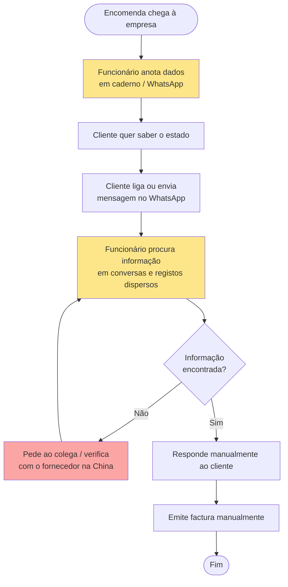
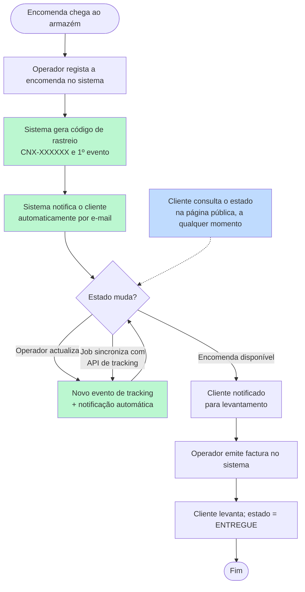

# Diagramas de Actividades — Processo Actual (AS-IS) vs Proposto (TO-BE)

## AS-IS — Processo manual actual (Capítulo 2 da monografia)

**Problemas evidenciados:** informação dispersa, dependência de pessoas, demora na resposta, risco de erro e extravio de dados.

## TO-BE — Processo com o sistema proposto

