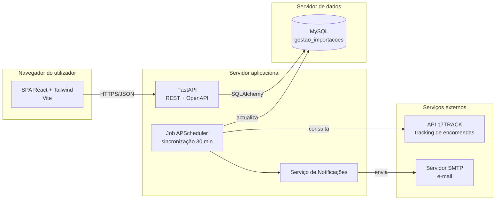
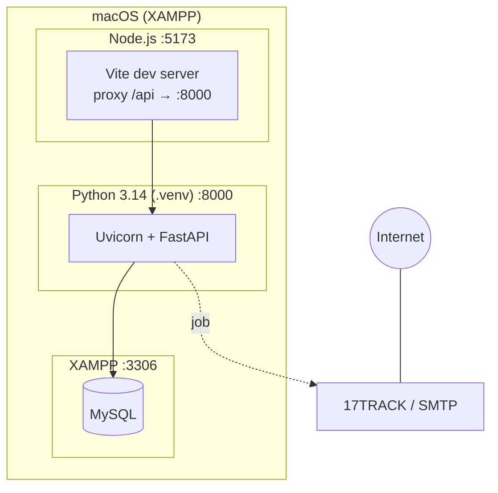

# Diagrama de Arquitectura e Implantação

## Arquitectura de componentes

## Implantação (ambiente de desenvolvimento)

**Camadas do backend:** `routers` (apresentação/REST) → `services` (regras de negócio) → `models` (persistência ORM) → MySQL. Esta separação corresponde ao padrão de arquitectura em camadas descrito na fase de concepção.
